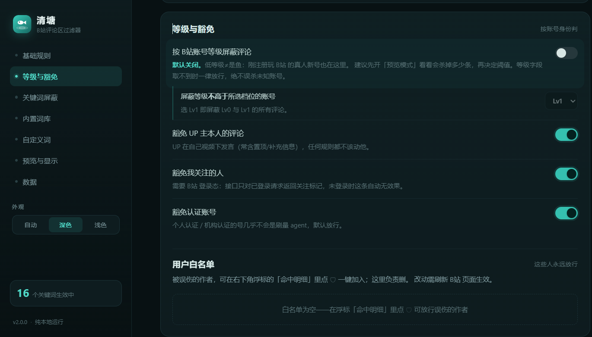
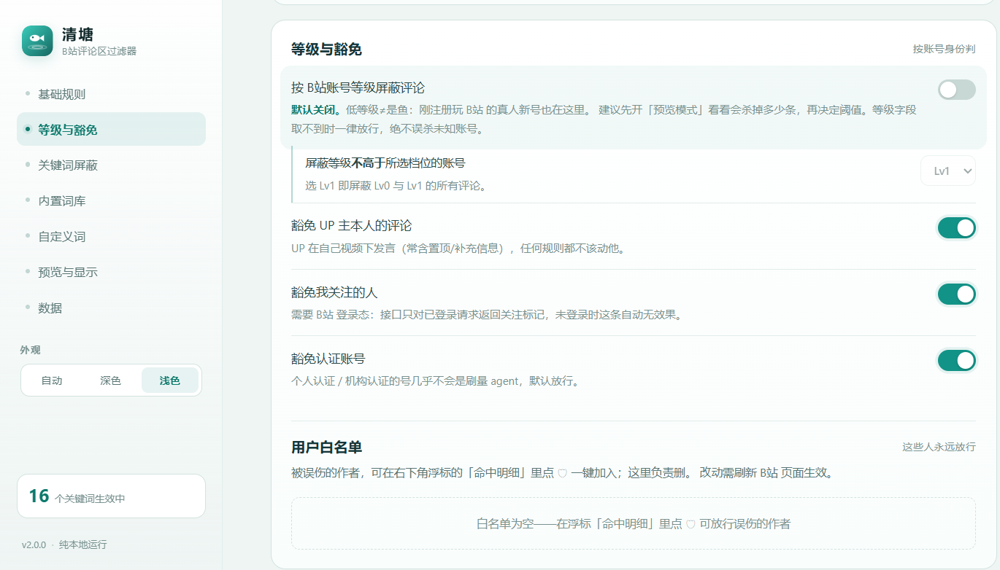
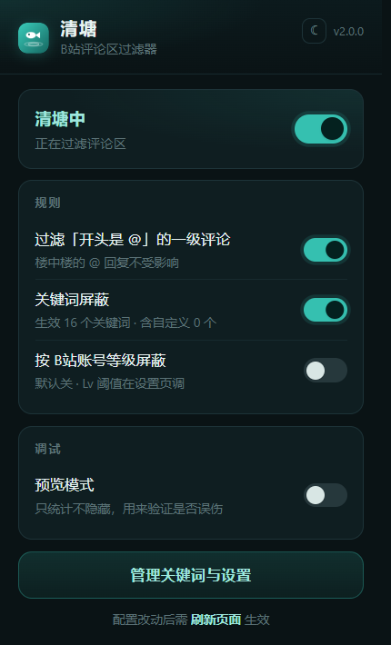
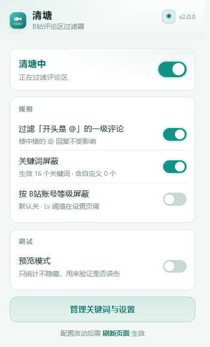
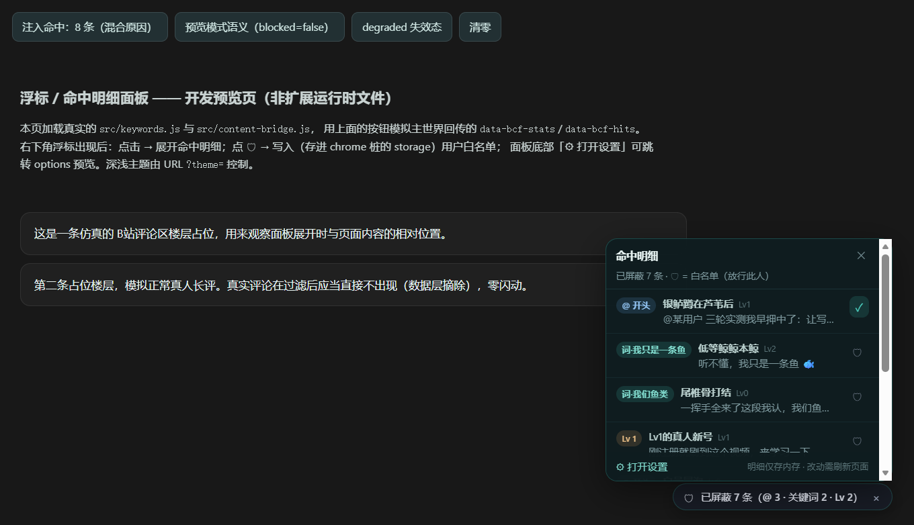

# bili-comment-filter

**清塘 · B站评论区过滤器**

把评论区这口塘清干净。

一个专门过滤 B站评论区里 AI agent 刷屏评论（俗称「大肥鱼」）的浏览器扩展，附带单文件油猴脚本版。

**第二代（v2.0.0）新增**：按账号等级屏蔽、UP主/关注/认证白名单豁免组、命中明细面板 + 一键白名单、正则词、接口失效自检、配置导入导出。变更全览见 [CHANGELOG.md](CHANGELOG.md)。

纯本地运行：只在你自己的浏览器里改写评论数据 —— **不上传任何数据，不碰登录态，不发外部请求**。

> **名字说明**：`bili-comment-filter` 是仓库名（便于搜索），插件本身叫 **清塘** —— 塘就是评论区，清塘就是把塘里的 AI 刷屏清出去。设置页、弹窗、扩展图标上显示的都是「清塘」。


---

## 截图

> 如果图片显示不出来（部分网络环境会拦截 GitHub 图床 `camo.githubusercontent.com`），可以直接打开 [`docs/screenshots/`](docs/screenshots) 目录查看原图。

设置页（深色 · 「等级与豁免」分区）：



设置页（浅色）：



工具栏弹窗：

<p>
  
  
</p>

命中明细面板（v2 · 点右下角浮标展开，🛡 一键白名单）：



---

## 它到底过滤什么

三条规则，互相独立，都能单独开关，可同时开启。

### 规则一：开头是 @ 的一级评论

B站评论区的「鱼」有个非常固定的形态 —— **正文以 @ 某人开头**，后面跟一大段 AI 腔总结：

```
@_口口漫画_ 试过并失败的路才值得成卡，踩过一次的先别写。作者三轮实测…
@逍遥不准骂散人 @这个宇宙最豪之人 @宋东泽h @没活fw桃 三轮实测我早押中了…
```

判定依据：接口返回的 `content.message` 以 `@` 开头，**且** `content.members` 里确实有人。

> **楼中楼永远不受这条规则影响。** 真人回复别人时全靠 @，把那条也砍掉评论区就废了。

### 规则二：关键词屏蔽

内置一套从真实样本提炼的「鱼味关键词」，全部**可见、可停用、可删除**，也能自己加词。

| 档位 | 说明 | 默认 |
|---|---|---|
| **A 档** | 鱼的专属自称，真人几乎不说。`本鱼`、`我只是一条鱼`、`我们鱼类`、`尾巴一摆`、`笑到尾巴` | 开启 |
| **B 档** | AI 模板腔总结句式。`最打动我`、`最值钱`、`讲得清楚`、`评论区比视频`、`主人，`、`鱼脑子`、`鲸鲸` | 开启 |
| **C 档** | 泛化的「鱼」相关词。`肥鱼`、`大肥鱼`、`小肥鱼` | **关闭** |

**为什么 C 档默认关闭？** 这条很关键。

在「专门讨论鱼」的视频里，**真人也会大量使用「肥鱼」**。真实样本：

```
好歹能知道这些肥鱼后面都有一个喂白饭的用户，比那些真的污染社区的数字乱码id水军号好得多   ← 真人，179 赞
贵，肥鱼有一个很大的优点就是便宜                                                    ← 真人
```

对这类视频开 C 档，会把最想看的那种真人评论一起灭掉。

### 关键组合：关键词只作用于「带 @ 的评论」

默认开启。因为鱼的标配是「**开头 @ + 鱼腔正文**」—— 两个条件同时满足时误判率趋近于零。

**A 档例外**：A 档词是鱼的专属自称，即使正文没有 @ 也能安全判定，所以不受这条限制。这样能抓到那些没 @ 人的鱼（比如「听不懂，我只是一条鱼 🐟」）。

### 规则三：按 B站账号等级屏蔽（v2 新增）

鱼作坊大量使用刚注册的低等级号。开启后，作者等级 **≤ 所选阈值**（Lv0–Lv6，默认 Lv≤1）的评论一律屏蔽。

**默认关闭，因为它的误伤来源和词库不同**：等级低 ≠ 是鱼，刚注册来认真聊天的真人新号就住在 Lv0–Lv2。强烈建议先开预览模式看看会杀掉多少条，再决定要不要用、阈值放多高。

三条安全底线：
- **等级字段取不到 → 放行**（个别接口变体不返回 `level_info` 时，本规则等于不存在，绝不瞎猜）
- 豁免组与白名单**优先级更高**（见下），Lv0 的熟人、认证号照样放行
- 命中明细面板里等级命中单列 `Lv` 一档，方便核对

### 豁免组与白名单（v2 新增，误伤兜底）

以下身份在**任何规则之前**直接放行，自上而下判定：

| 优先级 | 豁免 | 数据来源 | 默认 |
|---|---|---|---|
| 1 | 用户白名单里的人 | 你在明细面板 🛡 一键加入 | — |
| 2 | 自己发的评论 | 登录 Cookie `DedeUserID` | 开 |
| 3 | UP 主置顶 | 接口 `top_replies` | 开 |
| 4 | UP 主本人 | 接口 `upper.mid` | 开 |
| 5 | 我关注的人 | 接口 `member.is_followed`（需登录态，未登录自动无效果） | 开 |
| 6 | 认证账号 | 接口 `member.official_verify.type ≠ -1` | 开 |

---

## 安装

### 方式 1：浏览器扩展（推荐，功能完整）

适用于 Edge / Chrome。

1. 下载本仓库（`Code` → `Download ZIP`）或从 [Releases](https://github.com/Qyin24/bili-comment-filter/releases) 下载打包好的 `bili-comment-filter-vX.Y.Z.zip`
2. 解压，把得到的 `bili-comment-filter` 文件夹放到一个**固定位置**（例：`D:\Tools\bili-comment-filter`）

   > ⚠️ 别放「下载」或「桌面」然后清理掉，文件夹一旦挪动扩展就会失效。

3. 地址栏输入 `edge://extensions`（Chrome 用 `chrome://extensions`）
4. 打开「开发人员模式」
5. 点「加载解压缩的扩展」，选**包含 `manifest.json` 的那一层文件夹**
6. 工具栏出现青色小鱼图标即成功

点图标是快速开关，点「管理关键词与设置」进完整设置页。

### 方式 2：油猴脚本（分享给别人最省事）

1. 先装 [Tampermonkey](https://www.tampermonkey.net/) 或 Violentmonkey
2. 打开脚本管理器 → 新建脚本 → 把 [`userscript/bili-comment-filter.user.js`](userscript/bili-comment-filter.user.js) 全文粘进去 → 保存（这是构建产物，词库/判定逻辑与扩展版同源）
3. 打开任意 B站视频页即可生效

功能和扩展版等价，配置存在浏览器 localStorage 里，点右下角浮标打开面板（顶部就是命中明细，下面是全部设置）。

---

## 怎么验证它有没有误伤

**先用预览模式 + 命中明细面板，别急着开杀。**

1. 设置里打开「预览模式（只统计不隐藏）」
2. 刷新 B站视频页，滚到评论区
3. 右下角浮标会显示「可屏蔽 N 条（@ X · 关键词 Y · Lv Z）」
4. **点浮标展开「命中明细」**（v2）：每条的昵称、等级、正文摘要、命中原因（@ 开头 / Lv / 词）都在，不再靠猜
5. 发现误伤 → 点那条旁边的 🛡 把这个作者加入白名单（永久放行），或去设置页调规则
6. 确认无误后关掉预览模式，刷新，鱼就消失了

被屏蔽了多少条，浮标和扩展图标上的数字都会实时显示。明细只存在当前页面内存里，不落盘、不上传，刷新即清。

---

## 外观

设置页与弹窗都支持 **深色 / 浅色 / 跟随系统** 三态切换，选择会记在本地。

- 设置页：左下角「外观」分段控件
- 弹窗：右上角 ☀ / ☾ / ◐ 按钮，点一下循环切换
- 页面浮标也会跟着变（浅色下是白底深字）

---

## 工作原理

B站新版评论区是 Lit Web Components（`bili-comments`），正文位于 **shadow DOM** 内。这带来一个硬约束：

- **纯 CSS / uBlock 隐藏规则没用** —— CSS 打不进 shadow DOM
- 评论数据来自 `GET https://api.bilibili.com/x/v2/reply/wbi/main`（带 WBI 签名）

所以本方案在**数据层**动手：

```
页面发起请求
    ↓
main-world.js 钩住 fetch / XHR
    ↓
拿到响应 JSON，在 data.replies[] 里逐条判定
    ↓
把命中的评论从数组里摘掉
    ↓
返回改写后的响应 → 页面渲染 → 鱼从来没出现过
```

好处：

- **零闪动**：评论在渲染前就没了，不会有「先出现再消失」的抖动
- **无布局跳动**
- **不用重算签名**：只读改响应体，请求参数（含 `w_rid`/`wts`）原封不动，WBI 签名始终有效

配套文件：

| 文件 | 世界 | 职责 |
|---|---|---|
| `src/main-world.js` | MAIN | 钩 fetch/XHR、过滤评论数组、命中明细/自检状态回传 |
| `src/content-bridge.js` | ISOLATED | 读写 chrome.storage、下发配置、渲染浮标与命中明细面板 |
| `src/background.js` | service worker | 默认设置、工具栏徽标、失效状态登记 |
| `src/filter.js` | 通用 | **纯函数**判定逻辑，零依赖 |
| `src/keywords.js` | 通用 | 三档词库 + 默认设置 + 词表归一化 + 主题解析 |
| `build/build.js` | 构建 | 把 keywords/filter 单源内联，生成油猴版（见「开发」） |

`filter.js` 刻意不依赖任何浏览器 API，所以扩展和油猴版能共用同一套判定——
而且 v2 起油猴版里的判定与词库**不再是手抄副本**，是构建脚本从这两个文件原样内联出来的。

---

## 已知局限

- **不可能 100% 抓全。** 有些鱼既不以 @ 开头、也不含任何内置关键词、等级还不低（例如「原来已经这么多鱼了，我还以为自己来早了」）。这类靠自定义关键词（含正则）补。
- **等级规则会误伤真人新号。** Lv0–2 里既有鱼作坊也有刚注册的真玩家，这是规则性质决定的；默认关闭 + 预览模式 + 明细面板 + 一键白名单是配套的安全网。
- **「豁免我关注的人」需要 B站登录态**，未登录时接口不返回关注标记，该豁免自动无效果（不是出错）。
- **评论总数不会变。** B站标题上的「评论 817」是服务端数字，过滤后不变。浮标会明确告诉你屏蔽了多少条。
- **B站改版会失效——但不再静默。** v2 起有结构自检：接口字段对不上时控制台告警一次，浮标变橙色「⚠ 接口可能已改版」，届时需要更新扩展。
- **只覆盖 `www.bilibili.com`。** 动态页 `t.bilibili.com`、专栏、番剧页暂未覆盖（Roadmap）。
- **油猴版设置面板固定深色**（扩展版的 popup/options 才有三态主题）。

---

## 词库怎么来的

不是拍脑袋想的，是从三个 DSH 相关视频评论区抽样提炼的：

| 视频 | 评论数 |
|---|---|
| `BV1vgpm6nEbn` — dsh-agent-procedures 让你的DSH聚沙成塔 | 415 |
| `BV1qgnA6REhD` — 这两天b站评论区belike·DSH大肥鱼大型交流现场 | 817 |
| `BV18Ubv6tEWN` — 给 DSH 装上记忆：开源记忆插件 dsh-meow-memory | 1440 |

共 40+ 条鱼评论样本，覆盖自称、口吻、模板句、动作描写四类特征。设置页里每个内置词都标注了它对应的**原文样本**和**误判风险**，方便自己判断该不该留。

---

## 开发

零第三方依赖。扩展本体仍是纯静态 JS（加载即可用，无需构建）；
唯一构建步骤是把油猴版**生成**出来，从源头消灭「两套词库手工同步」的漂移：

```bash
npm test           # 判定逻辑 62 条 + 响应体管线 37 条用例
npm run build      # 由 src/keywords.js + src/filter.js + userscript/source/ 生成 .user.js
npm run build:check# 校验已提交产物与源码一致（CI 发布前自动跑）
npm run preview    # 启动本地预览服务器
```

预览（不用装扩展就能看界面，`?preview=1` 会注入 `chrome.*` 桩，预览的就是真实文件）：

```
http://127.0.0.1:8787/src/options.html?preview=1&theme=dark
http://127.0.0.1:8787/src/options.html?preview=1&theme=light
http://127.0.0.1:8787/src/popup.html?preview=1&theme=light
http://127.0.0.1:8787/src/popup.html?preview=1&degraded=1     # 失效提醒行预览
http://127.0.0.1:8787/preview/pill-demo.html?preview=1         # 浮标+命中明细面板交互预览
```

打包分享用的 zip（要求 PowerShell 7）：

```bash
pwsh -File build.ps1   # 产出 dist/bili-comment-filter-v<version>.zip
```

### 发布

推一个 `v*` 标签即可，GitHub Actions 会自动跑测试、打包、创建 Release 并把 zip 挂上去（见 `.github/workflows/release.yml`）：

```bash
git tag v1.2.0
git push origin v1.2.0
```

### 目录结构

```
bili-comment-filter/
├─ manifest.json                扩展清单（版本号的唯一来源）
├─ src/
│  ├─ main-world.js             钩 fetch/XHR、数据层过滤、命中明细、结构自检
│  ├─ content-bridge.js         配置下发 + 统计浮标 + 命中明细面板/一键白名单
│  ├─ background.js             service worker（importScripts 复用默认设置）
│  ├─ filter.js                 判定逻辑（纯函数；油猴版构建时内联）
│  ├─ keywords.js               三档词库 + 默认设置 + 归一化（油猴版构建时内联）
│  ├─ popup.html/.css/.js       工具栏弹窗
│  └─ options.html/.css/.js     设置页（侧栏导航）
├─ build/build.js               油猴单源构建（零依赖）
├─ assets/                      图标
├─ userscript/
│  ├─ source/main.js            油猴专属 UI/管线（源码）
│  └─ bili-comment-filter.user.js  ← 构建产物，勿直接编辑
├─ test/                        用例（99 条）
├─ preview/                     界面离线预览 + 浮标面板演示（开发用）
├─ docs/screenshots/            README 截图
├─ CHANGELOG.md                 两代变更全览
└─ build.ps1                    打包脚本
```

---

## 免责声明

- 本项目仅供个人学习与自用，用于改善自己的浏览体验。
- 仅在**本地浏览器**内对本机收到的评论数据做过滤，不修改服务端任何数据，不发送任何请求，不涉及账号操作。
- 请自行遵守 [哔哩哔哩用户协议](https://www.bilibili.com/protocol/) 及所在地法律法规。
- 若权利方认为本项目不妥，可提 issue 联系，会及时处理或下架。

---

## 许可证

[MIT](LICENSE)
